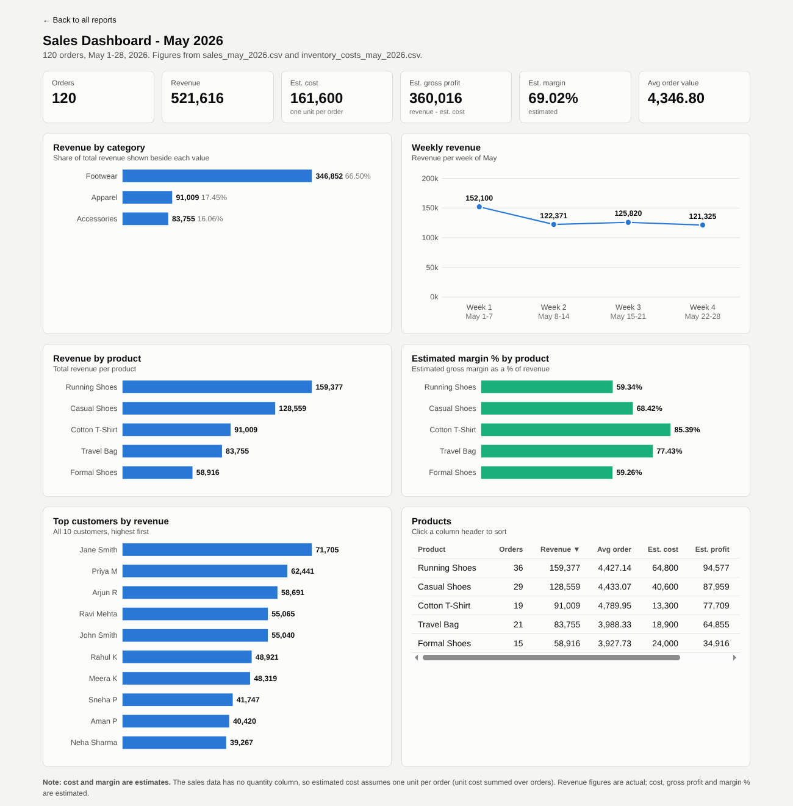
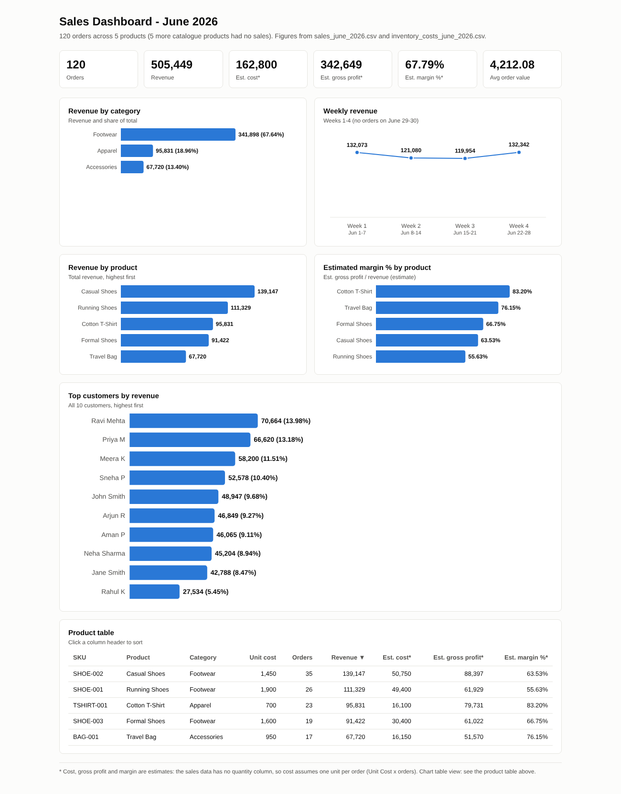
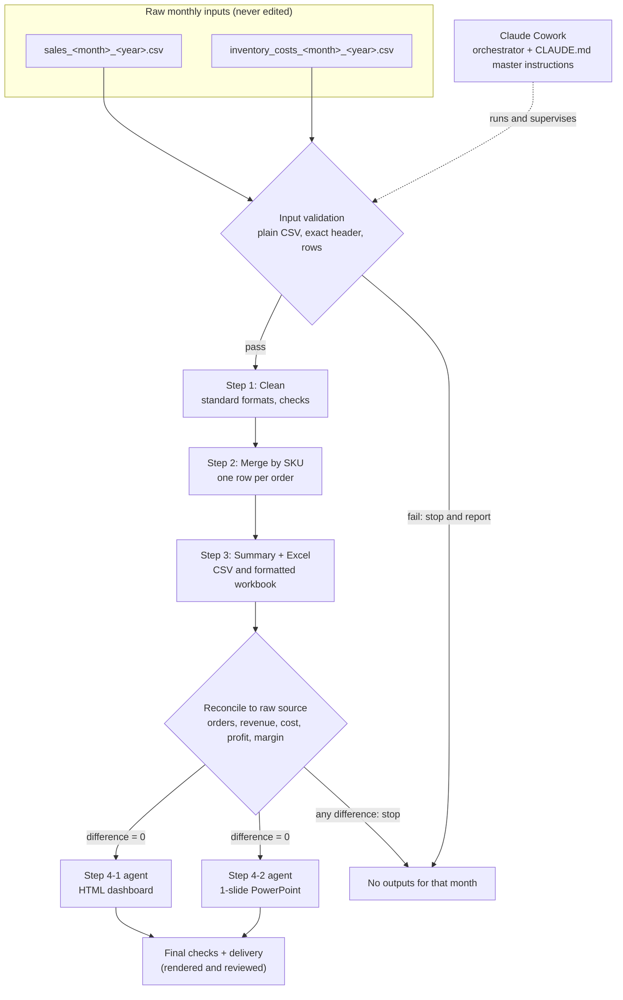
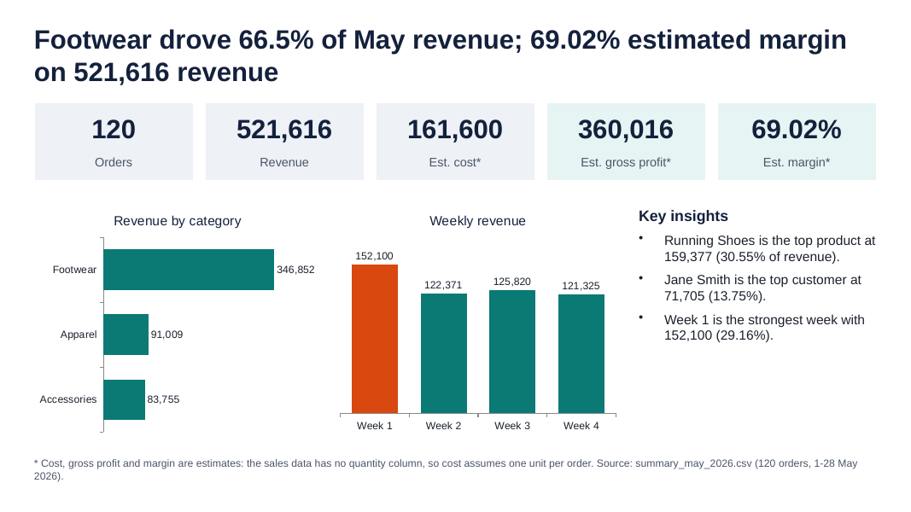
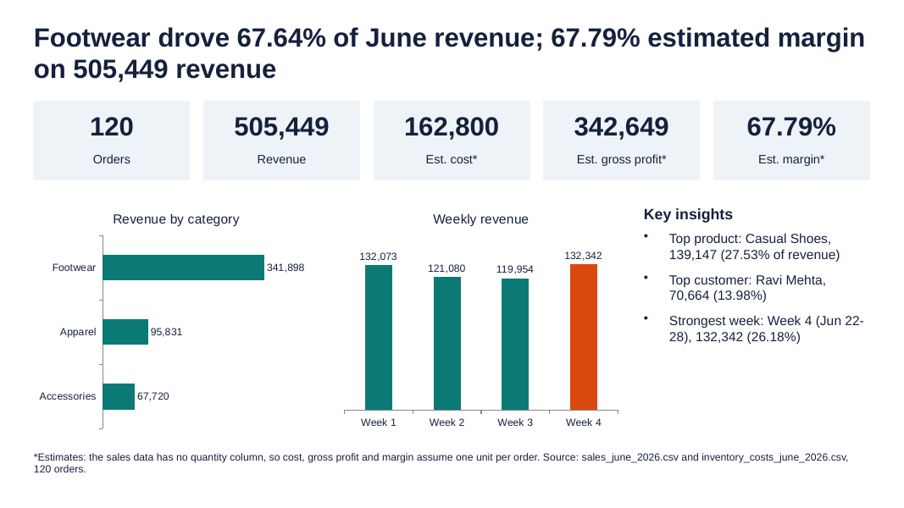

# Monthly Sales Reporting Pipeline

An AI-orchestrated data pipeline that turns two raw monthly CSV files (sales and inventory costs) into a validated, reconciled set of business reports: a cleaned dataset, a merged file, a summary, a formatted Excel workbook, an interactive HTML dashboard and a one-slide executive PowerPoint.

The pipeline is defined as plain-language Markdown instruction files and run by [Claude Cowork](https://www.anthropic.com/claude) with specialised AI agents. This repository is a portfolio project in data engineering and AI workflow automation.

**Live dashboards** (open locally after cloning):
[May 2026](docs/dashboard_may_2026.html) | [June 2026](docs/dashboard_june_2026.html) | [landing page](docs/index.html)

Once GitHub Pages is enabled for this repository, the same pages will be available at <https://billyeson.github.io/monthly-sales-reporting-pipeline/> (not live until Pages is turned on).

| May 2026 dashboard | June 2026 dashboard |
|---|---|
|  |  |

## Business problem

Every month the same reporting job repeats: take the raw sales and inventory-cost exports, fix inconsistent formats, join them, check the numbers, and produce reports for different audiences (analysts, managers, executives). Done by hand it is slow and error-prone, and mistakes in joins or totals are easy to miss.

This project automates that job and, more importantly, makes it **checkable**: every deliverable is reconciled back to the raw files, and the pipeline stops instead of producing reports when a check fails.

## Architecture



Steps 1 to 3 run strictly in order; each must pass its checks before the next starts. Steps 4-1 and 4-2 only read the Step 3 outputs and each writes its own file, so they run in parallel as two agents.

## Workflow

| Step | Instruction file | Reads | Produces |
|---|---|---|---|
| 1. Clean | [`workflow/step1-clean-data.md`](workflow/step1-clean-data.md) | raw sales and inventory CSVs | two `*_clean.csv` files |
| 2. Merge by SKU | [`workflow/step2-merge-data.md`](workflow/step2-merge-data.md) | the clean files (reconciled to raw) | `merged_sales_inventory_<month>_<year>.csv` |
| 3. Summary and Excel | [`workflow/step3-summary.md`](workflow/step3-summary.md) | merged file (reconciled to raw) | `summary_<month>_<year>.csv`, `summary_<month>_<year>_formatted.xlsx` |
| 4-1. Dashboard | [`workflow/step4-1-dashboard.md`](workflow/step4-1-dashboard.md) | summary and merged files | `dashboard_<month>_<year>.html` |
| 4-2. Executive slide | [`workflow/step4-2-executive-ppt.md`](workflow/step4-2-executive-ppt.md) | summary and merged files | `executive_summary_<month>_<year>.pptx` |

[`CLAUDE.md`](CLAUDE.md) is the master reference: folder layout, month detection, input validation, reconciliation rules and standing assumptions. Each step file also has a History section that records what each run did.

## Technologies

- **Claude Cowork** to orchestrate the run, with **Claude agents / subagents** for the parallel dashboard and slide steps
- **Python and pandas** for cleaning, merging, aggregation and validation (all columns read as strings so nothing is silently converted)
- **openpyxl** for the Excel workbook (live formulas on a `Source Data` sheet, recalculated and checked for formula errors)
- **HTML, CSS, JavaScript and inline SVG** for a self-contained dashboard with no external dependencies
- **pptxgenjs** for the native-chart PowerPoint slide
- **Headless Chrome and LibreOffice** to render the dashboard and slide to images so they can be visually checked
- Plain **Markdown instruction files** as the pipeline definition

## Validation and reconciliation

The raw input files are the source of truth. These checks come from [`CLAUDE.md`](CLAUDE.md) and the step files:

- **Input validation:** each raw file must be real plain-text CSV with exactly the expected header, at least one data row, and no web page or error text. A file that fails is reported, not repaired. In the June run, a first inventory file turned out to be a saved "504 Gateway Time-out" web page and was rejected; the pipeline only ran after a corrected file was supplied.
- **Cleaning:** standard SKU, Order ID, name and date formats; no duplicate Order IDs or SKUs; every sales SKU exists in inventory; all dates fall inside the month taken from the file name; cleaning must not change any revenue, product name, category or unit cost; input files are unchanged afterwards (size, modified time, hash).
- **Merge:** left join with `validate='m:1'`; every order matches an inventory row; row count equals the raw sales row count; no blank values.
- **Reconciliation to raw (difference must be 0):** orders, revenue, estimated cost, gross profit and margin are recomputed independently from the raw files and compared with the merged file, the summary CSV, the Excel workbook, the dashboard and the slide. Overall totals come from the order rows, never from adding up the product, category, customer or week sections.
- **Section checks:** product, category, customer and week sections each add back to total orders and revenue.
- **Rendering checks:** the Excel workbook is recalculated with zero formula errors; the dashboard and slide are rendered and inspected.
- **Flag, do not change:** odd categories (for example Sports Socks under Footwear), abbreviated customer names, and anything needing a business decision are reported to the user, never silently corrected.

> **Cost is an estimate.** The sales data has no quantity column, so estimated cost = unit cost x number of orders (one unit per order). Cost, gross profit and margin are labelled as estimates in every deliverable. If a future file has a quantity column, the instructions say to use unit cost x quantity and drop the "Est." labels.

## Deliverables

Per month, the pipeline produces the files below. **All of them are published here** for May and June 2026.

| Deliverable | Files |
|---|---|
| Raw practice datasets (inputs) | [`data/input/`](data/input/) |
| Cleaned sales and inventory CSVs | [`data/intermediate/`](data/intermediate/) |
| Merged sales + inventory CSV | [`data/intermediate/`](data/intermediate/) |
| Summary CSV | [`reports/may_2026/`](reports/may_2026/summary_may_2026.csv), [`reports/june_2026/`](reports/june_2026/summary_june_2026.csv) |
| Formatted Excel workbook | [`reports/may_2026/`](reports/may_2026/summary_may_2026_formatted.xlsx), [`reports/june_2026/`](reports/june_2026/summary_june_2026_formatted.xlsx) |
| Interactive HTML dashboard | [`docs/dashboard_may_2026.html`](docs/dashboard_may_2026.html), [`docs/dashboard_june_2026.html`](docs/dashboard_june_2026.html) |
| One-slide executive PowerPoint | [`reports/may_2026/`](reports/may_2026/executive_summary_may_2026.pptx), [`reports/june_2026/`](reports/june_2026/executive_summary_june_2026.pptx) |

| May 2026 executive slide | June 2026 executive slide |
|---|---|
|  |  |

### The Excel workbook

Each month's workbook has two sheets. `Source Data` holds the merged order rows (real dates, unit cost, revenue) plus a `Week` formula. `Sales Summary` stacks five sections (OVERALL, BY PRODUCT, BY CATEGORY, BY CUSTOMER, BY WEEK) in which **every number is a live formula** on `Source Data` (`COUNTA`, `SUM`, `COUNTIFS`, `SUMIFS`, `INDEX/MATCH`, `IFERROR`); overall totals are computed from the order rows, never by adding the overlapping sections. Formatting is Arial with shaded headers, `#,##0.00` amounts and `0.00%` margins stored as fractions. The workbooks contain formulas and formatting only: there are no charts or images (the charts live in the dashboard and the slide).

## Results: May and June 2026

Figures below are read from the published summary CSVs. Each month was reconciled to its raw source files with a difference of 0 for orders, revenue, estimated cost, gross profit and margin.

| Metric | May 2026 | June 2026 |
|---|---:|---:|
| Orders | 120 | 120 |
| Revenue | 521,616 | 505,449 |
| Est. cost* | 161,600 | 162,800 |
| Est. gross profit* | 360,016 | 342,649 |
| Est. margin* | 69.02% | 67.79% |
| Average order value | 4,346.80 | 4,212.08 |
| Top category | Footwear (346,852, 66.5%) | Footwear (341,898, 67.64%) |
| Top product | Running Shoes (159,377, 30.55%) | Casual Shoes (139,147, 27.53%) |
| Top customer | Jane Smith (71,705, 13.75%) | Ravi Mehta (70,664, 13.98%) |
| Strongest week | Week 1 (May 1-7) (152,100, 29.16%) | Week 4 (Jun 22-28) (132,342, 26.18%) |

\* Estimates: cost assumes one unit per order because the sales data has no quantity column.

Both months were reconciled and rendered before delivery. For this publication the figures were also cross-checked across formats: the raw source files, the summary CSV, the Excel workbook, the dashboard and the PowerPoint slide all agree on orders, revenue, estimated cost, gross profit, margin and average order value (difference 0 for both months), and the Excel sections match the summary CSV row by row. June 29-30 had no orders, so June has four weekly sections and no Week 5.

## How to reproduce

**Prerequisites:** Claude Cowork (or another Claude environment that can read your project folder, run Python, and launch subagents), plus the usual Python data tooling (pandas, openpyxl), Node with pptxgenjs, headless Chrome and LibreOffice for rendering. The instruction files are the source of truth for exact behaviour.

1. **Set up a project folder** (the `<PROJECT_FOLDER>` placeholder in the instruction files). Put `CLAUDE.md` and the five step files from `workflow/` side by side in it, as the instructions expect, and create an `input/` folder (in this repository the raw files are in `data/input/`):
   ```
   <PROJECT_FOLDER>/
     CLAUDE.md
     step1-clean-data.md ... step4-2-executive-ppt.md
     input/      raw monthly files go here (never edited)
     output/     generated files go here
   ```
2. **Add a month of data** named `sales_<month>_<year>.csv` and `inventory_costs_<month>_<year>.csv` (full lowercase English month name, four-digit year, e.g. `sales_may_2026.csv`). Expected headers: sales `Order ID, Customer Name, Product SKU, Order Date, Revenue`; inventory `SKU, Product Name, Category, Unit Cost`. Source dates are expected day-first (`dd/mm/yy`).
3. **Run the pipeline** by sending this prompt to Claude Cowork (from `CLAUDE.md`), replacing the month and year:
   > Run the monthly sales pipeline for `<Month> <Year>`. Follow CLAUDE.md in this project folder: Steps 1, 2 and 3 in order, then Steps 4-1 and 4-2 in parallel. Validate and reconcile to the source data, keep the input files unchanged and tell me what you produced.
4. **Review** the reconciliation report and the rendered dashboard and slide before using them.

**The practice datasets are included.** The original May and June raw files are in [`data/input/`](data/input/), and the files each step produced are in [`data/intermediate/`](data/intermediate/) and [`reports/`](reports/), so every stage can be compared with your own run. To reproduce a month, copy that month's two raw files into the `input/` folder of your project folder and run the prompt above; then compare your outputs with the published ones (the reconciliation figures in [Results](#results-may-and-june-2026) should match exactly).

## How AI is used in this project

This project was built and run with **Claude Cowork and specialised AI agents**, and I want that to be clear rather than implied:

- The pipeline logic lives in human-readable Markdown instruction files that Claude follows; the Python, Excel, dashboard and slide code is generated by Claude while executing those instructions.
- **Subagents:** Steps 4-1 (dashboard) and 4-2 (slide) run as two parallel agents, each reading the Step 3 outputs and writing only its own file. A coordinating Claude session runs Steps 1 to 3, supervises the agents and checks their results.
- **Human in the loop:** I define the instructions and standing rules, supply the input files, review the outputs and decide what to publish. For example, a failed June input was caught by validation and reported instead of being processed, and a late layout fix to the June dashboard was caught in review.
- This repository's preparation (structure, documentation, dashboard publishing and quality checks) was also done with AI agents, with a human-approval gate before anything was published. The cross-format reconciliation was written by Claude and verified by recomputing the figures independently from the raw files.
- AI can still make mistakes. The reconciliation rules exist so that numbers are verified against the raw data rather than trusted.

### Known limitations and flagged items

- Cost, gross profit and margin are **estimates** (one unit per order, no quantity column).
- Flagged but intentionally not changed: Sports Socks is filed under Footwear in the inventory data; some customer names are abbreviated (for example `Priya M`); in June, order ORD-2022 has revenue (1,842) below its product's unit cost (1,900); some inventory products had no sales in either month.
- Customer-level views reflect names exactly as supplied in the source data.
- The instructions are written for this specific column layout and file-naming convention.

## Data and licensing

- **Educational source:** the May and June 2026 source files (`sales_*` and `inventory_costs_*`) are **fictional educational practice datasets** provided as course/instructor practice material. The repository owner has confirmed that the data are fictional and that the instructor permits students to publish them. The customer names, products and prices are not real business records.
- The cleaned and merged files, summaries, workbooks, dashboards and slides are derived from those practice datasets.
- This is a learning and portfolio project; nothing here represents real company performance.
- The code and instruction files are released under the MIT licence (below). The practice datasets are published with the instructor's permission for educational purposes and are not separately relicensed.

## Repository layout

```
CLAUDE.md                master instructions
workflow/                the five step instruction files
data/input/              original practice datasets (raw sales and inventory CSVs)
data/intermediate/       cleaned and merged CSVs
reports/may_2026/        summary CSV + formatted Excel + executive slide
reports/june_2026/       summary CSV + formatted Excel + executive slide
docs/                    GitHub Pages site: landing page + both dashboards
assets/                  screenshots used in this README
```

## Licence

[MIT](LICENSE) for the code and instruction files. Copyright holder: billyeson. The practice datasets are covered by the instructor's permission described above, not by this licence.
